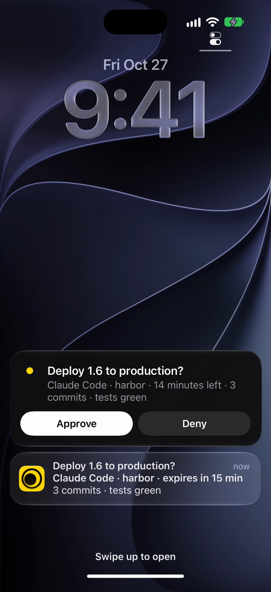

# Monish

Monish puts what your coding agent does on your iPhone lock screen: results, failures, live progress, and yes or no questions you answer with Approve or Deny without unlocking.



## Requirements

- An iPhone on iOS 17.2 or later, with [Monish from the App Store](https://apps.apple.com/app/apple-store/id6822071271?pt=128786655&ct=github&mt=8).
- Node 18 or later, for `npx monish`.
- `jq` for the hook. It ships with macOS 15 and later; otherwise `brew install jq` or `apt install jq`.

## Install

1. Get [Monish on the App Store](https://apps.apple.com/app/apple-store/id6822071271?pt=128786655&ct=github&mt=8). It is free, with no account. During onboarding it gives you a setup line that contains your key (`an_…`).
2. In a terminal:

```bash
claude plugin marketplace add mariusapps-afk/monish
claude plugin install monish@monish
npx monish setup
```

`npx monish setup` asks for that line or the key alone, saves the key, offers to add the Monish rule for Codex and Cursor, and sends the "Connected" ping that finishes onboarding in the app. On Codex, Cursor, or Claude Code without plugins, `npx monish setup` alone is enough: it also installs the skill and the hook.

## Claude Code commands

```bash
npx monish pair 482913        # the 6-digit code shown in the Monish app; --name "MacBook Pro" to rename this computer
npx monish status             # pairing, iPhone app version, hooks, Node path, Claude Code version
npx monish test               # sends a test permission request to your iPhone; nothing is run
npx monish uninstall          # removes the hooks and unpairs this computer
npx monish uninstall --all    # also removes the key, the skill and the Codex and Cursor rules
```

`pair` copies the tool to `~/.config/monish/monish.js`, saves this computer's token in `~/.config/monish/computer.json` (readable by you only) and adds six hooks to `~/.claude/settings.json` (or `$CLAUDE_CONFIG_DIR/settings.json`, or the file it links to): `PermissionRequest`, `Elicitation`, `Stop`, `StopFailure`, `PostToolUse` and `UserPromptSubmit`. Your other hooks are kept and the previous file is saved as `settings.json.monish-backup`; `uninstall` removes exactly what `pair` added.

From then on, Claude Code's permission prompts, plans, questions, MCP forms and the end of each turn reach your iPhone, and the first answer wins: on the iPhone or in the terminal. While you type in Claude's terminal, your iPhone only gets a silent note, and a request the terminal answered is closed on the iPhone. If you reply to the end of a turn, Claude takes the reply as its next instruction. The hooks send what the request shows (the command and its description, the file path, the plan, the questions, the form or the end-of-turn message), the project folder name, a short hash of the session id and this computer's name to `https://monish.cc`. Needs Node 18 or later; macOS and Linux, Windows in beta.

## What you get

- **A ping when Claude Code is stuck.** When Claude Code stops for your permission or for an MCP form, your phone rings with the project name and what it is waiting for. One line per project, updated in place, so a task blocked for an hour does not ring twenty times.
- **The `monish` skill.** Claude decides when a finished task, a failure, a long-running progress bar (a Live Activity on the lock screen), a few figures, or a question deserves your phone. Questions come with Approve and Deny buttons on the lock screen, and Claude reads your answer.
- **Any agent, any script.** It is one HTTPS endpoint, so Codex, Cursor, cron jobs, CI and n8n can use it with `curl`. The full contract is at [monish.cc/skill](https://monish.cc/skill).

```bash
npx monish ping "Backup finished" --body "214 files, 3.2 GB"
```

## What it runs and sends

- **Hook** (`hooks/notify.sh`): runs on Claude Code `Notification` events, keeps only `permission_prompt` and `elicitation_dialog`, and posts the notification text, the project folder name and your key to `https://monish.cc/v1/send`. It needs `jq` and `curl`, times out after 5 seconds, always exits 0, and does nothing when no key is saved.
- **Skill** (`skills/monish/SKILL.md`): instructions that tell Claude when and how to call the same endpoint with `curl`.
- **CLI** (`npx monish setup`): writes your key to `~/.config/monish/key` (readable by you only), downloads the skill from `https://monish.cc/skill` to `~/.claude/skills/monish/SKILL.md`, writes `~/.config/monish/hook.sh` and adds one `Notification` hook to `~/.claude/settings.json` or the file it links to (existing hooks are kept, the previous file is saved as `settings.json.monish-backup`), adds one rule to `~/.codex/AGENTS.md` or `.cursor/rules/monish.mdc` only if you say yes, then sends one ping. When the plugin is enabled, the CLI skips the skill and the hook. No dependencies, no telemetry.

## Uninstall

1. Remove the plugin: `claude plugin uninstall monish@monish`, then `claude plugin marketplace remove monish`.
2. Remove what `npx monish setup` wrote, the key and the hook script included:

```bash
rm -rf ~/.config/monish ~/.claude/skills/monish ~/.claude/settings.json.monish-backup
```

3. In `~/.claude/settings.json`, delete the `Notification` entry whose command is `~/.config/monish/hook.sh`. If you added the Monish rule, delete it from `~/.codex/AGENTS.md` or `.cursor/rules/monish.mdc`.

## Privacy

There is no account. Your key stays on your machine and in the app. What your agents send is kept 48 hours on our server, then deleted; answers are kept 24 hours. Details in the [privacy policy](https://monish.cc/privacy).

## Links

- [Monish on the App Store](https://apps.apple.com/app/apple-store/id6822071271?pt=128786655&ct=github&mt=8)
- [monish.cc](https://monish.cc)
- [API and rules for agents](https://monish.cc/skill)
- [Claude Code notifications on iPhone](https://monish.cc/claude-code-notifications-iphone)
- [Codex notifications on iPhone](https://monish.cc/codex-notifications)
- [Approve from the lock screen](https://monish.cc/approve-from-lock-screen)
- [n8n and scripts to iPhone](https://monish.cc/n8n-iphone-notifications)
- [Monish vs Pushary vs Agentfy vs ntfy](https://monish.cc/compare)
- [Support](https://monish.cc/support)

## License

[MIT](LICENSE), Marius Labs.
