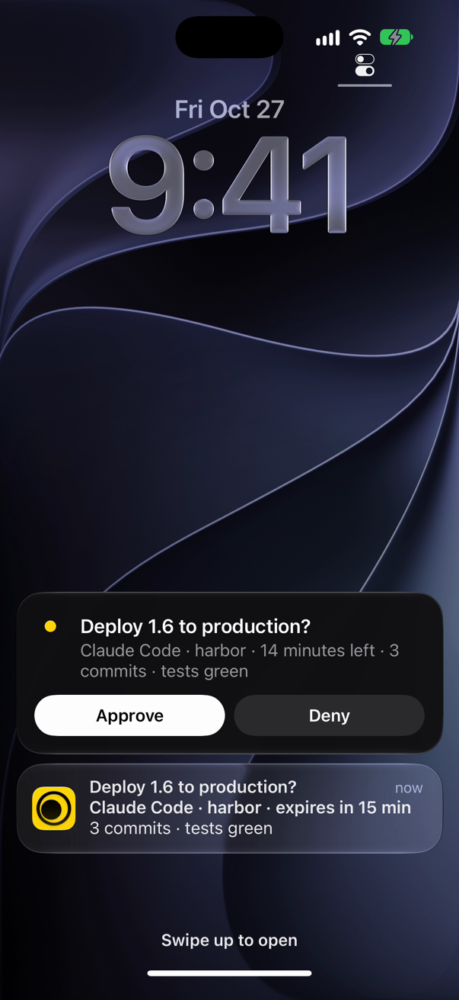

# Monish

Monish puts what your coding agent does on your iPhone lock screen: results, failures, live progress, and yes or no questions you answer with Approve or Deny without unlocking.



## Install

1. Get [Monish on the App Store](https://apps.apple.com/app/apple-store/id6822071271?pt=PT_PLACEHOLDER&ct=github&mt=8). It is free, with no account. During onboarding it gives you a setup line that contains your key (`an_…`).
2. In a terminal:

```bash
claude plugin marketplace add mariusapps-afk/monish
claude plugin install monish@monish
npx monish setup
```

`npx monish setup` asks for that line or the key alone, saves the key, offers to add the Monish rule for Codex and Cursor, and sends the "Connected" ping that finishes onboarding in the app. On Codex, Cursor, or Claude Code without plugins, `npx monish setup` alone is enough: it also installs the skill and the hook.

## What you get

- **A ping when Claude Code is stuck.** When Claude Code stops for your permission or for an MCP form, your phone rings with the project name and what it is waiting for. One line per project, updated in place, so a task blocked for an hour does not ring twenty times.
- **The `monish` skill.** Claude decides when a finished task, a failure, a long-running progress bar (a Live Activity on the lock screen), a few figures, or a question deserves your phone. Questions come with Approve and Deny buttons on the lock screen, and Claude reads your answer.
- **Any agent, any script.** It is one HTTPS endpoint, so Codex, Cursor, cron jobs, CI and n8n can use it with `curl`. The full contract is at [monish.cc/skill](https://monish.cc/skill).

```bash
npx monish ping "Backup finished" --body "214 files, 3.2 GB"
```

## What it runs and sends

- **Hook** (`hooks/notify.sh`): runs on Claude Code `Notification` events, keeps only `permission_prompt` and `elicitation_dialog`, and posts the notification text, the project folder name and your key to `https://monish.cc/v1/send`. It needs `jq` and `curl`, times out after 5 seconds, always exits 0, and does nothing when no key is saved.
- **Skill** (`skills/monish/SKILL.md`): instructions that tell Claude when and how to call the same endpoint with `curl`.
- **CLI** (`npx monish setup`): writes your key to `~/.config/monish/key` (readable by you only), downloads the skill from `https://monish.cc/skill` to `~/.claude/skills/monish/SKILL.md`, writes `~/.config/monish/hook.sh` and adds one `Notification` hook to `~/.claude/settings.json` (existing hooks are kept, the previous file is saved as `settings.json.monish-backup`), adds one rule to `~/.codex/AGENTS.md` or `.cursor/rules/monish.mdc` only if you say yes, then sends one ping. When the plugin is enabled, the CLI skips the skill and the hook. No dependencies, no telemetry.

## Privacy

There is no account. Your key stays on your machine and in the app. What your agents send is kept 48 hours on our server, then deleted; answers are kept 24 hours. Details in the [privacy policy](https://monish.cc/privacy).

## Links

- [Monish on the App Store](https://apps.apple.com/app/apple-store/id6822071271?pt=PT_PLACEHOLDER&ct=github&mt=8)
- [monish.cc](https://monish.cc)
- [API and rules for agents](https://monish.cc/skill)
- [Support](https://monish.cc/support)

## License

[MIT](LICENSE), Marius Labs.
